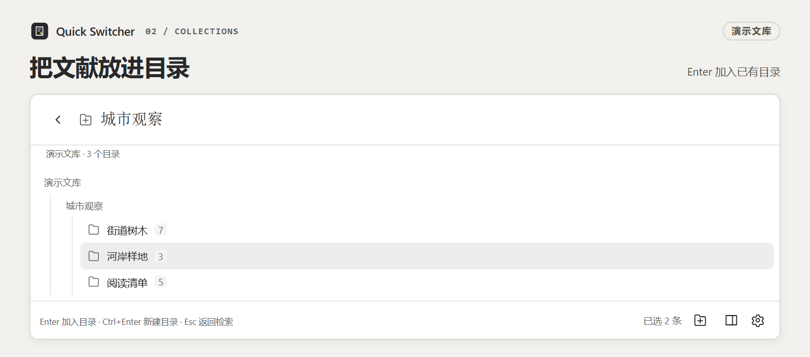
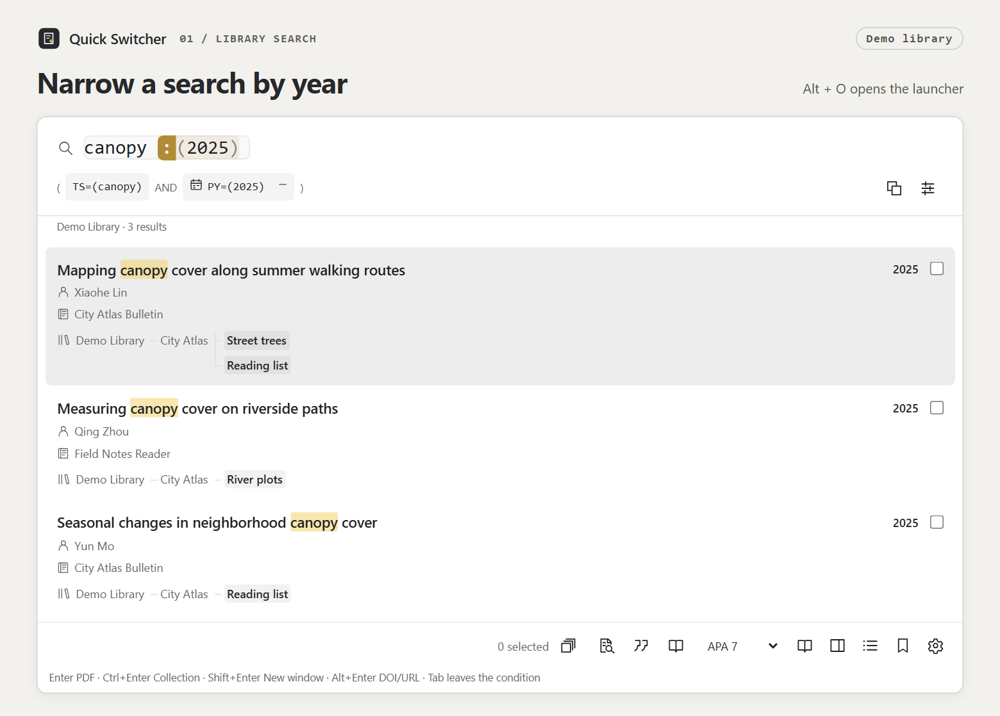
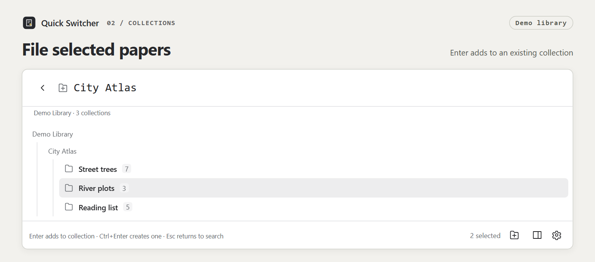

# Zotero Quick Switcher

[中文](#readme-zh) · [English](#readme-en) · [下载插件 / Download the XPI][releases]

<a id="readme-zh"></a>

## 中文

Zotero Quick Switcher 是 Zotero 10 的键盘启动器。在同一个面板里，你可以查文献、切换正在读的 PDF、跳到目录或运行命令。检索结果会标出匹配的文字，也会列出文献实际所属的目录。

[安装](#install-zh) · [快速上手](#start-zh) · [检索语法](#syntax-zh) · [设置与同步](#sync-zh) · [开发](#dev-zh)


两张演示图中的文献、作者和目录均为虚构。

### 功能

| 功能 | 用途 |
| --- | --- |
| 文献检索 | 搜索当前文库或所有文库，按作者、年份、标签、出版来源、类型和目录筛选，也可检索 RSS 条目。 |
| 匹配高亮 | 在结果、Zotero 条目列表和右侧信息栏标出匹配文字，查看摘要、笔记、批注或附件全文中的片段。 |
| 目录位置 | 显示文献的多处归属，共用的上级路径只显示一次，直接所属的目录会高亮。 |
| 阅读预览与切换 | 预览 PDF，切换标签页，按大纲标题跳转或分屏阅读。大纲会跟随当前章节，检索时保留上级标题。 |
| 目录与命令 | 进入目录、保存搜索或 RSS，运行当前可用的 Zotero 和插件命令。 |
| 复制与批量操作 | 多选文献，批量打开、定位、加入目录，或按选定的 CSL 样式复制引文和参考文献；也可以直接复制 PDF 文件。 |
| 保存搜索 | 将常用查询存为动态搜索，拖入同一文库的目录，或排在其他搜索和目录前后。可用 WebDAV 同步这套布局。 |

<a id="install-zh"></a>

### 安装

需要 **Zotero 10.0.7 或更新的 10.x 版本**。

1. 在 [Releases][releases] 下载 `.xpi` 安装包。普通用户不需要下载源码 ZIP。
2. 在 Zotero 打开「工具 → 插件」，点击齿轮，选择「从文件安装插件」，选中下载的 `.xpi`。
3. 按 `Alt+O` 打开检索。在 Zotero 设置的 **Zotero Quick Switcher** 中可以修改快捷键、检索范围和外观。

安装后，Zotero 会从[本仓库的更新清单][updates]检查新版本。要手动检查，可在「工具 → 插件」的齿轮菜单中选择「检查更新」。

<a id="start-zh"></a>

### 快速上手

按 `Alt+O`。空输入显示最近阅读；输入关键词搜索当前文库，例如 `树冠 :(2025)`。用上下方向键选中文献，按 `Enter` 打开首选 PDF 或 EPUB。附件已经打开时切到已有标签页；没有阅读附件时，在文库中选中条目。`Esc` 关闭面板。

普通检索默认以灰色提示最近 3 秒内复制的纯文本。按空格采用这段文字，按 `Enter` 采用并执行；直接输入会丢弃建议。可在「检索 → 使用最近复制的文字」关闭建议，或把有效时长改为 1 至 60 秒。高级搜索和独立切换模式不读取剪贴板，未确认的建议不写入查询历史。

#### 默认入口

| 快捷键 | 入口 | 用法 |
| --- | --- | --- |
| `Alt+Shift+O` | 全局检索 | Zotero 运行时，从其他应用唤起独立检索窗口。 |
| `Alt+O` | 文献检索 | 查找文献，查看匹配片段和 PDF 预览。 |
| `Alt+F` | 高级搜索 | 在 Zotero 原生条件编辑器中编辑当前查询。 |
| `Alt+;` | 标签页切换 | 按最近使用顺序筛选已打开的标签页。 |
| `Alt+'` | 当前 PDF 大纲 | 查找章节标题，跳转或分屏阅读。 |
| `Alt+/` | 目录切换 | 筛选文库、目录、保存搜索和 RSS，预览其中的条目。 |
| `Alt+P` | 命令面板 | 输入命令名称，或用 `@` 选择 Zotero 或某个插件作为来源，按 `Enter` 执行。 |

在设置中点击快捷键，再按下新的组合；`Esc` 取消录入。macOS 上用 `Option` 对应 `Alt`。全局快捷键可单独更改，录入时按 `Backspace` 或 `Delete` 可停用。Windows 上的独立窗口在鼠标所在屏幕打开，可拖动边框调整大小；按 `Esc` 隐藏，下次唤起时复用该窗口。

标签页、大纲和目录是独立的切换模式，输入只筛选文字。目录切换从当前目录或正在读的 PDF 所属目录开始。

#### PDF 大纲跟随与样式

按 `Alt+'` 打开大纲，面板会选中正在读的章节；分屏时以当前活动的阅读栏为准。子标题按层级缩进，右侧列出页码。输入关键词后只匹配标题文字，高亮命中词，并保留上级标题，方便区分不同章节下的同名小节。

面板和 Zotero 阅读器左侧的大纲都按段滚动：当前标题在视口上半部时不动，移出这一区域才将它滚到顶部。原生侧栏已经滚到底时，自动跟随不会再把它拉回去；按 `↑`、`↓` 仍可主动导航。

#### 回车动作

| 模式 | `Enter` | `Shift+Enter` | `Ctrl/Cmd+Enter` | `Alt+Enter` |
| --- | --- | --- | --- | --- |
| 文献检索 | 打开阅读附件 | 在新窗口打开 PDF | 进入文献的第一个所属目录并选中文献 | 打开 DOI，没有 DOI 时打开 URL |
| 标签页切换 | 切到该页 | 在新窗口打开 PDF | 未分配 | 打开 DOI，没有 DOI 时打开 URL |
| 大纲切换 | 跳到该节 | 在分屏中跳到该节 | 未分配 | 未分配 |
| 目录切换 | 进入目录 | 进入上级目录 | 未分配 | 未分配 |

在「检索」和「切换」设置中可以重新分配这些组合、留空，或把同一动作分给多个组合。文献检索和标签页模式还可分配为复制 PDF、引文或参考文献。大纲分屏会按窗口比例选择左右或上下排列，点击分屏右上角的 `×` 可回到单栏。

#### 多选与批量操作

文献检索、标签页、大纲和目录面板都支持多选：

- `Ctrl/Cmd+Space` 或 `Ctrl/Cmd+点击` 切换一行的选择；`Shift+↑/↓` 或 `Shift+点击` 选择连续范围。
- 焦点在结果或操作区时，`Ctrl/Cmd+A` 选中全部匹配项，包括尚未显示的结果。焦点在输入框时，同一组合只全选查询文字，按 `Backspace` 或 `Delete` 可清空。
- 对多选结果执行动作时，失败项保留选择，方便重试。中途改变查询或选择会停止处理剩余条目。批量定位以第一篇文献的所属目录为准：能在该目录显示的文献一起选中，其余保留为未完成项。

要把几篇文献放进同一目录，先勾选文献，再点击右下角带加号的文件夹。输入目录名或上级路径，多个词用空格隔开，必须全部匹配。按 `Enter` 加入选中的已有目录；输入新名称后按 `Ctrl/Cmd+Enter`，会在文库顶层新建目录并加入文献。只能选同一文库的普通目录。文献原有的归属不变，也不会重复加入。完成或按 `Esc` 取消后，回到原查询和选择。

<details>
<summary>示例：把两篇文献加入「河岸样地」</summary>



</details>

#### 复制 PDF、引文与参考文献

| 快捷键 | 文献检索或标签页模式下的复制内容 |
| --- | --- |
| `Ctrl/Cmd+C` | 所选文献的本机 PDF 文件。若只选中了查询文字、没有勾选结果，仍按普通文本复制。 |
| `Ctrl/Cmd+Shift+A` | 文内引文，使用当前 CSL 样式。 |
| `Ctrl/Cmd+Shift+C` | 参考文献表，使用当前 CSL 样式。 |

PDF 按文件复制，目标软件需支持粘贴文件。引文和参考文献同时提供 HTML 和纯文本。批量复制会去重，缺少本机 PDF 的条目保留以便重试。

面板底部的 CSL 菜单可临时切换样式。在「检索 → 引用复制」中可设置默认样式、语言和按应用匹配的规则。例如，Windows 上可为 `powerpnt.exe` 选简短的样式，为 `winword.exe` 选 GB/T 7714；macOS 上对应的应用名是 `Microsoft PowerPoint` 和 `Microsoft Word`。样式需先安装到 Zotero。规则匹配唤起面板前使用的外部应用，不读取文档标题；手动选择优先，无法识别应用时用默认样式。

PPT CSL 推荐：

- [Zotero丨专门用于PPT引用文献的格式 - Achuan-2](https://www.achuan-2.top/post/zotero-gun-format-for-ppt-reference-literature-1usphn.html)
- [适合制作PowerPoint报告时候使用的Zotero引文样式 | BIO-SPRING](https://bio-spring.top/post/2016/10/25/2016-10-25-zotero-author-journal-year-style/)

<a id="syntax-zh"></a>

### 检索语法

默认搜索题名、创建者、年份、DOI、引用键、标签和完整摘要。在「正文来源」还可勾选笔记、批注和附件全文。作者条件也匹配编辑者、贡献者等创建者，支持中英文姓名、全拼和小鹤双拼。

| 默认引导符 | 条件 | 示例 |
| --- | --- | --- |
| `@` | 作者或其他创建者 | `@(linxiaohe)` |
| `#` | Zotero 条目标签 | `#(待读)` |
| `/` | 目录、文库、保存搜索或 RSS | `/(街道树木)` |
| `:` | 年份 | `:(2024 OR 2025)` |
| `!` | 期刊、出版来源或出版社 | `!(城市样刊)` |
| `%` | 条目类型 | `%(journalArticle)` |
| `'` | PDF 大纲标题 | `'(Methods)` |
| `;` | 已打开标签页中的文献 | `;(*)` |
| `>` | 开头限定当前目录 | `>树冠` |
| 空格 | 本次检索启用全部字段和正文来源 | 先按一次空格，再输入关键词 |

输入引导符会出现条件块和候选列表。`Enter` 选定候选，`Tab` 离开当前块继续输入；相邻的条件块之间可以不加空格。引导符可在设置中修改，目录、大纲和标签页的引导符随对应快捷键的主键变化。

输入 `#` 可浏览所选文库中的标签。按 `Enter` 选中某个标签，只看带该标签的文献；也可以直接输入 `#待读`，匹配名称含「待读」的标签。`#(待读) :(2025)` 可以进一步限定年份。

多个词默认按 `AND` 连接。用 `AND`、`OR`、`NOT` 和括号组合条件；双引号保留完整短语或字段值。未加引号的条件支持 `*` 和 `?`。要搜索引导符或括号本身，在前面加反斜杠，如 `\@Draft`、`\(`。

```text
树冠 "步行道温度"
树冠 @(linxiaohe) :(2024 OR 2025)
/(街道树木) AND /(阅读清单)
(树冠 OR 河岸) NOT !(城市样刊)
```

#### 结果与预览

结果列出题名、创建者、年份、出版来源和目录树。点击作者、年份、出版来源或路径中的任一目录，会把它加入查询。按住 `Ctrl/Cmd` 点击高亮的直接所属目录，会进入该目录、选中文献并标出文献的其他归属；用同一组合点击普通上级路径则打开该目录。附件、子笔记和批注沿用顶层文献的目录位置。

结果列表会先填满一屏，不足一屏就显示全部。往下翻到当前这批的中段，下一批就开始加载，不用滚到底。标签、作者和目录里的文献预览也按预览区的高度加载。

展开预览可查看元数据、匹配片段和 PDF。PDF 按需加载：标签页预览显示正在读的页，大纲预览显示所选标题对应的页。

#### Web of Science 检索式

按默认设置，`树冠 :(2025)` 可复制为 `(TS=(树冠) AND PY=(2025))`。条目标签、目录、标签页和大纲只在 Zotero 中有意义，复制时会略去，并保留其余条件之间的布尔关系。只有年份，或表达式无法安全转换时，面板会说明原因，不覆盖剪贴板。WoS 的收录范围和字段内容与本机文库不同，两边的结果不一定相同。

### 高级搜索与保存搜索

按 `Alt+F`，或点击检索式旁的高级按钮，把当前查询转到 Zotero 原生条件编辑器。可调整字段、运算符和条件组，再保存为动态搜索。收起编辑器再展开，已编辑的条件仍在；超过五行条件时，可在条件区内滚动。跨文库检索需要先选定一个文库才能保存。

原生条件随文献和目录成员变化而更新。作者别名和带通配符的目录名、标签名在保存时展开：若后来新增匹配的名称，须重新检索并保存。原生编辑器没有标签页和大纲这两类条件，它们由插件在运行时计算；停用插件或扩展规则尚未同步时，这类保存搜索返回空结果。

#### 将保存搜索放进目录并排序

在 Zotero 左侧文库树中，拖动**保存搜索本身**。放在同一文库的目录行中央，会把它移入该目录；放在目录或另一条保存搜索的上、下边缘，看到横线后松手，就会排在目标前、后。拖到文库名称上可移回顶层。右键保存搜索，选「恢复默认搜索位置」可撤销自定义位置。

移动搜索不会把命中的文献加入目录。要归档当前结果，先打开保存搜索，在中间的条目列表中选中文献，再把所选条目拖到目标目录。以后新命中的文献不会自动加入这个普通目录。

<a id="sync-zh"></a>

### 设置与同步

设置分为「检索」「切换」「命令」「外观」「WebDAV 同步」五页。可调整快捷键、默认范围、预览、面板大小、主题和高亮颜色。界面语言可跟随 Zotero，也可单独选 English 或简体中文。默认不会恢复上次查询；配置支持导入、导出和重置。

不配置 WebDAV 也能检索。需要跨设备同步时，在每台设备上分别填写地址、用户名和凭据。凭据存入本机安全存储，可单独关闭插件设置同步。

| 数据 | 去向 |
| --- | --- |
| 文献元数据、原生查询条件、文献的目录归属 | 由 Zotero 同步。 |
| 保存搜索布局、扩展查询规则、可移植设置（含回车动作和 CSL 规则） | 通过插件的 WebDAV 同步。 |
| WebDAV 用户名和凭据、设备标识、全局快捷键、查询历史、最近阅读 | 留在本机，不写入配置导出文件。 |

布局改动立即在本机生效。离线时保留待同步的改动；启用自动同步后，默认每 60 秒检查一次，合并冲突，失败时显示错误。服务器地址不参与自动同步，但手动导出的配置包含该地址，分享文件前请检查。

<a id="dev-zh"></a>

### 开发

需要 Node.js 22.12 或更新版本，以及 Python 3（Windows 用 `python`，macOS/Linux 用 `python3`，也可用 `PYTHON` 指定解释器）。在仓库根目录运行：

```sh
npm ci
npm run build
```

安装包在 `dist/`，`updates.json` 记录下载地址和 SHA-256。`src/` 是插件逻辑，`addon/` 包含安装清单和界面资源，`scripts/` 负责检查和打包。`npm run check` 检查语法和清单，`npm test` 运行 `tests/` 中的开发回归测试；`npm run verify` 依次检查、测试、构建。测试文件不进入 `.xpi`。

### 使用限制与反馈

PDF 预览、大纲和文件复制都需要本机可读的附件；全文检索受 Zotero 索引范围限制。按拼音查作者时可能遇到同名或同音，请结合题名和出版信息判断。命令面板只能列出 Zotero 和插件公开的命令。

全局快捷键仅支持 Windows 和 macOS，可能与其他应用冲突。macOS 全局唤起以及向 Word／PowerPoint 粘贴的实际效果尚未在相应环境中验证。遇到问题请在 [Issues][issues] 附上 Zotero 和插件版本、操作系统、复现步骤及相关快捷键。通常不需要上传文库或含私人信息的截图。

### 许可

项目采用 [AGPL-3.0-or-later][license]。安装包内附完整许可证，以及 [Zotero 的署名和商标声明、拼音库 `pinyin-pro` 的 MIT 许可][third-party]。

<a id="readme-en"></a>

## English

Zotero Quick Switcher is a keyboard launcher for Zotero 10. Use one panel to find a paper, switch to a PDF you have open, jump to a collection or run a command. Search results show the matching text and the collections each paper belongs to.

[Installation](#install-en) · [Quick start](#start-en) · [Search syntax](#syntax-en) · [Settings and sync](#sync-en) · [Development](#dev-en)



The papers, authors and collections in both examples are fictional.

### Features

| Feature | What it does |
| --- | --- |
| Library search | Search the current library or all libraries, including RSS items. Combine filters for author, year, tag, publication, item type and collection. |
| Match highlighting | See what matched in the results, Zotero’s item list and the item details pane. Read snippets from abstracts, notes, annotations or attachment text. |
| Collection paths | See every collection an item belongs to. Shared parent paths appear once; direct memberships stand out. |
| Reading and previews | Preview a PDF, switch tabs or jump to a heading in the current view or a split pane. The outline follows your reading position and keeps parent headings visible when you search. |
| Collections and commands | Open a collection, saved search or RSS feed. Run commands available from Zotero and its plugins in the current context. |
| Clipboard and batch actions | Open, locate or file several papers at once. Copy their PDFs, or copy citations and bibliography entries in your chosen CSL style. |
| Saved searches | Save a query, move it into a collection in the same library, or place it before or after another search or collection. WebDAV can sync this layout. |

<a id="install-en"></a>

### Installation

Requires **Zotero 10.0.7 or a later 10.x release**.

1. Download the `.xpi` file from [Releases][releases]. You don’t need the source ZIP to install the plugin.
2. In Zotero, open **Tools → Plugins**, click the gear, choose **Install Plugin From File**, and select the `.xpi`.
3. Press `Alt+O` to open search. To change the shortcuts, search scope or appearance, open **Zotero Quick Switcher** in Zotero’s settings.

Zotero checks this repository’s [update feed][updates] for new versions. To check manually, open **Tools → Plugins** and choose **Check for Updates** from the gear menu.

<a id="start-en"></a>

### Quick start

Press `Alt+O`. Leave the search box empty to see recent reading, or type a query such as `canopy :(2025)` to search the current library. Pick a paper with the arrow keys. `Enter` opens its preferred PDF or EPUB, switches to the attachment’s tab if it’s already open, or selects the item in the library if it has no reader attachment. `Esc` closes the panel.

If you copied plain text in the last three seconds, regular search shows it in gray. Press Space to keep the text, `Enter` to accept and act on it, or start typing to discard it. Under **Search → Use recently copied text**, you can turn suggestions off or set the time limit to between 1 and 60 seconds. Advanced search and the dedicated switchers don’t read the clipboard. Unaccepted suggestions stay out of your query history.

#### Default shortcuts

| Shortcut | Mode | What it does |
| --- | --- | --- |
| `Alt+Shift+O` | Global search | Open a separate search window from another app while Zotero is running. |
| `Alt+O` | Item search | Find papers, read matching passages and preview PDFs. |
| `Alt+F` | Advanced search | Edit the current query in Zotero’s native condition editor. |
| `Alt+;` | Tab switcher | Filter open tabs, most recently used first. |
| `Alt+'` | PDF outline | Find a heading and jump to it in the current view or a split pane. |
| `Alt+/` | Collection switcher | Find a library, collection, saved search or RSS feed and preview its items. |
| `Alt+P` | Command palette | Type a command name, or use `@` to pick Zotero or a plugin as the source. Press `Enter` to run the command. |

To change a shortcut, click it in settings and press the new combination. `Esc` cancels. On macOS, use `Option` for `Alt`. The global shortcut has its own setting; press `Backspace` or `Delete` while recording to disable it. On Windows the separate window opens on the screen containing the pointer. Drag its border to resize it or press `Esc` to hide it. Calling it up again reuses the same window.

The tab, outline and collection switchers use plain text, not the query syntax. The collection switcher starts at the selected collection or one containing the PDF you’re reading.

#### Following the PDF outline

Press `Alt+'` to open the outline at the section you’re reading. In split view, it uses the active pane. Subheadings are indented and page numbers line up on the right. Searching highlights matches in heading text and keeps the parent headings, so you can tell two sections with the same name apart.

Both the switcher and Zotero’s outline sidebar leave the active heading alone while it’s in the top half of the viewport. When it moves outside that area, it scrolls to the top. Once the sidebar reaches the bottom, automatic scrolling stops there; you can still navigate with `↑` and `↓`.

#### What Enter does

| Mode | `Enter` | `Shift+Enter` | `Ctrl/Cmd+Enter` | `Alt+Enter` |
| --- | --- | --- | --- | --- |
| Item search | Open the reader attachment | Open the PDF in a new window | Select the item in the first collection it belongs to | Open the DOI, or the URL if there’s no DOI |
| Tab switcher | Switch to the tab | Open the PDF in a new window | Unassigned | Open the DOI, or the URL if there’s no DOI |
| PDF outline | Jump to the heading | Open the heading in a split pane | Unassigned | Unassigned |
| Collection switcher | Open the collection | Open its parent | Unassigned | Unassigned |

Under **Search** and **Switchers**, you can reassign a combination, leave it blank or give the same action more than one shortcut. In item search and the tab switcher, you can also assign a shortcut to copy a PDF, citation or bibliography. The outline splits the reader side by side or top to bottom according to the window’s proportions. Click the `×` at the top right of the split to return to one pane.

#### Selecting and filing several items

These shortcuts work in item search and in the tab, outline and collection switchers:

- `Ctrl/Cmd+Space` or `Ctrl/Cmd+click` toggles a row. Use `Shift+↑/↓` or `Shift+click` for a range.
- With focus on the results or action buttons, `Ctrl/Cmd+A` selects every match, including results that haven’t loaded yet. In the search box it selects the query text instead; `Backspace` or `Delete` clears it.
- If an action fails for some items, they stay selected for another try. Changing the query or selection stops the rest of the batch. When locating several papers, the plugin opens a collection containing the first paper, selects the papers visible there and leaves the others pending.

To file several papers together, select them and click the folder with a plus sign at the bottom right. Type a collection name or part of its parent path. If you enter several words, all must match. Press `Enter` to add the papers to the highlighted collection. To create a top-level collection, type its name and press `Ctrl/Cmd+Enter`. The picker accepts regular collections in the same library only. Filing keeps the papers’ existing memberships and doesn’t add duplicates. Finishing or cancelling with `Esc` returns you to your search and selection.

<details>
<summary>Example: filing two papers in River plots</summary>



</details>

#### Copying PDFs, citations and bibliographies

| Shortcut | What it copies in item search or the tab switcher |
| --- | --- |
| `Ctrl/Cmd+C` | The selected papers’ local PDF files. If you highlighted query text and didn’t check any results, it copies the text instead. |
| `Ctrl/Cmd+Shift+A` | An in-text citation in the current CSL style. |
| `Ctrl/Cmd+Shift+C` | A bibliography in the current CSL style. |

PDFs go on the clipboard as files, so the receiving app must support pasting files. Citations and bibliographies are available as both HTML and plain text. Batch copying removes duplicates; when a local PDF is missing, that item stays selected for another try.

Use the CSL menu at the bottom of the panel to switch styles for the current task. Under **Search → Citations**, set a default style and language or choose styles by app. On Windows, for example, assign a short style to `powerpnt.exe` and GB/T 7714 to `winword.exe`. On macOS, use the names `Microsoft PowerPoint` and `Microsoft Word`. Install the styles in Zotero first. Rules use the app you were in before opening the launcher; they don’t read document titles. A manual choice takes precedence. If the plugin can’t identify the app, it uses the default style.

PPT CSL Recommend：

- [Zotero丨专门用于PPT引用文献的格式 - Achuan-2](https://www.achuan-2.top/post/zotero-gun-format-for-ppt-reference-literature-1usphn.html)
- [适合制作PowerPoint报告时候使用的Zotero引文样式 | BIO-SPRING](https://bio-spring.top/post/2016/10/25/2016-10-25-zotero-author-journal-year-style/)

<a id="syntax-en"></a>

### Search syntax

By default, search covers titles, creators, years, DOIs, citation keys, tags and full abstracts. Under **Text sources**, you can also include notes, annotations and attachment full text. The author filter includes editors, contributors and other creators. It accepts Chinese and English names, full pinyin and Xiaohe double pinyin.

| Default prefix | Filter | Example |
| --- | --- | --- |
| `@` | Author or other creator | `@(linxiaohe)` |
| `#` | Zotero item tag | `#("to read")` |
| `/` | Collection, library, saved search or RSS feed | `/("Street trees")` |
| `:` | Year | `:(2024 OR 2025)` |
| `!` | Journal, publication or publisher | `!("City Atlas Bulletin")` |
| `%` | Item type | `%(journalArticle)` |
| `'` | PDF outline heading | `'(Methods)` |
| `;` | Papers in open tabs | `;(*)` |
| `>` | Current collection, when typed first | `>canopy` |
| Space | All fields and text sources for this search | Press Space once before typing the keywords |

A prefix opens a filter and a list of suggestions. Press `Enter` to choose a suggestion and `Tab` to leave the filter and keep typing. Adjacent filters don’t need a space between them. You can change the prefixes in settings. The collection, outline and tab prefixes follow the main key of their respective switcher shortcuts.

Type `#` to browse tags in the selected library or libraries. Press `Enter` on a tag to find items with that exact tag, or type `#review` to match tag names containing “review”. Combine `#("to read")` with `:(2025)` to narrow your reading list by year.

Terms are joined with `AND` by default. Use `AND`, `OR`, `NOT` and parentheses to group conditions. Double quotes preserve a phrase or field value; unquoted conditions accept `*` and `?`. To search for a prefix or parenthesis literally, escape it with a backslash, as in `\@Draft` or `\(`.

```text
canopy "walking route temperature"
canopy @(linxiaohe) :(2024 OR 2025)
/("Street trees") AND /("Reading list")
(canopy OR riverside) NOT !("City Atlas Bulletin")
```

#### Results and previews

Results show the title, creators, year, publication and collection tree. Click an author, year, publication or any collection in a path to add it to the query. `Ctrl/Cmd+click` a highlighted collection to open it, select the paper and show its other memberships. The same gesture on an ordinary parent path opens that collection. Attachments, child notes and annotations use the top-level item’s collection paths.

Results fill the pane unless there are too few matches to fill one screen. The next batch starts loading about halfway through the current one. Item lists in tag, author and collection previews use the height of the preview pane instead.

Expand the preview to see metadata, matching passages and the PDF. PDF pages load on demand: a tab preview shows the page you’re reading, and an outline preview shows the page for the selected heading.

#### Web of Science queries

With the default settings, `canopy :(2025)` copies as `(TS=(canopy) AND PY=(2025))`. The copy omits Zotero tags, collections, tabs and outline filters, and keeps the Boolean relationships between the remaining conditions. If only a year remains or the expression can’t be converted safely, the panel explains why and leaves the clipboard untouched. WoS indexes different publications and fields, so its results can differ from your local results.

### Advanced search and saved searches

Press `Alt+F` or click the advanced search button beside the query to open Zotero’s native condition editor. Edit fields, operators or groups, then save the query as a dynamic search. Collapsing and reopening the editor keeps your edits. If there are more than five rows of conditions, scroll within the editor. For a cross-library query, choose one library before saving.

Native conditions update as items and memberships change. Author aliases and wildcard collection or tag names expand when you save: run the query and save it again to include new matching names. Zotero’s native editor has no fields for tabs or PDF outlines; the plugin evaluates those filters when the search runs. A saved search that depends on them returns no results if the plugin is disabled or the rules haven’t synced yet.

#### Moving and sorting saved searches

Drag the **saved search itself** in Zotero’s left-hand library tree. Drop it in the middle of a collection row to move it inside that collection. To change its order, drag to the upper or lower edge of a collection or another saved search and release when the insertion line appears. Drop it on the library name to return it to the top level. To undo a custom placement, right-click the search and choose **Reset search location**.

Moving a search doesn’t file the papers it finds. To add the current results to a collection, open the saved search, select the papers in the middle pane, and drag those items to the collection. Future matches won’t be added to the collection automatically.

<a id="sync-en"></a>

### Settings and sync

There are five settings tabs: **Search**, **Switchers**, **Commands**, **Appearance** and **WebDAV sync**. They cover shortcuts, default scope, previews, panel size, theme and highlight colors. The interface can follow Zotero’s language or use English or Simplified Chinese. Restoring the last query is off by default. You can import, export or reset your configuration.

Search works without WebDAV. To sync across devices, enter the server URL, username and credentials on each device. The plugin keeps credentials in local secure storage. You can turn off settings sync separately.

| Data | Where it goes |
| --- | --- |
| Item metadata, native search conditions and collection memberships | Zotero syncs these. |
| Saved-search layout, extended query rules and portable settings, including Enter actions and CSL rules | The plugin syncs these over WebDAV. |
| WebDAV username and credentials, device ID, global shortcut, query history and recent reading | Stay on the device and are left out of configuration exports. |

Layout changes take effect locally right away, including when you’re offline. With automatic sync enabled, the plugin checks every 60 seconds by default, merges conflicting changes and reports any errors. The server URL doesn’t sync, but it does appear in manually exported settings. Check that file before sharing it.

<a id="dev-en"></a>

### Development

Use Node.js 22.12 or newer and Python 3 (`python` on Windows, `python3` on macOS/Linux, or set `PYTHON` to your interpreter). From the repository root:

```sh
npm ci
npm run build
```

The installable file is in `dist/`. Its download URL and SHA-256 are in `updates.json`. `src/` holds the plugin logic, `addon/` the install manifest and interface resources, and `scripts/` the checks and packaging tools. Run `npm run check` for syntax and manifest checks or `npm test` for the regression suite in `tests/`. `npm run verify` runs the checks, tests and build in order. The `.xpi` includes no test files.

### Limitations and feedback

PDF previews, outlines and file copying need a locally readable attachment. Full-text search is limited to what Zotero has indexed. Pinyin searches can match different people with the same name or pronunciation; check the title and publication to tell them apart. The command palette can list only commands that Zotero or a plugin exposes.

The global shortcut is available only on Windows and macOS and may conflict with other apps. The global shortcut on a Mac and pasting into Word or PowerPoint haven’t been verified in those environments. To [report an issue][issues], include your Zotero and plugin versions, operating system, steps to reproduce and any relevant shortcuts. You usually don’t need to share your library or a screenshot containing personal information.

### License

Licensed under [AGPL-3.0-or-later][license]. The XPI includes the full license, along with [Zotero’s copyright and trademark notices and the MIT license for `pinyin-pro`][third-party].

[releases]: https://github.com/pasiooooo/zotero-quickSwitcher/releases/latest
[updates]: https://raw.githubusercontent.com/pasiooooo/zotero-quickSwitcher/main/updates.json
[issues]: https://github.com/pasiooooo/zotero-quickSwitcher/issues
[license]: LICENSE
[third-party]: addon/content/THIRD-PARTY-LICENSES.txt
[ppt-ref]: https://www.achuan-2.top/post/zotero-gun-format-for-ppt-reference-literature-1usphn.html
[author-journal-year]: https://bio-spring.top/post/2016/10/25/2016-10-25-zotero-author-journal-year-style/
